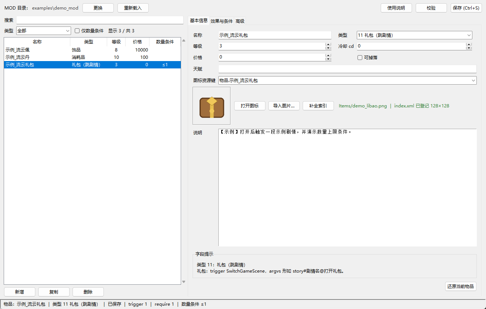
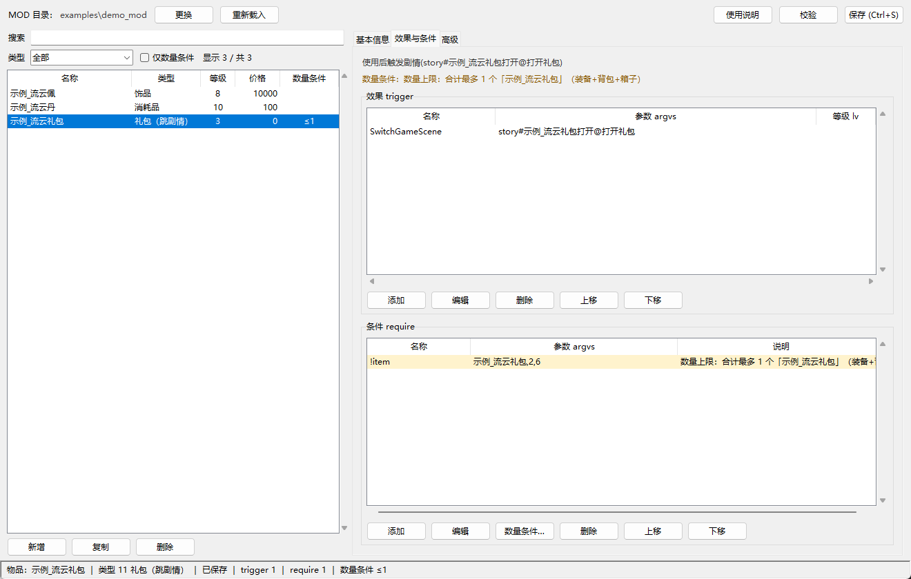
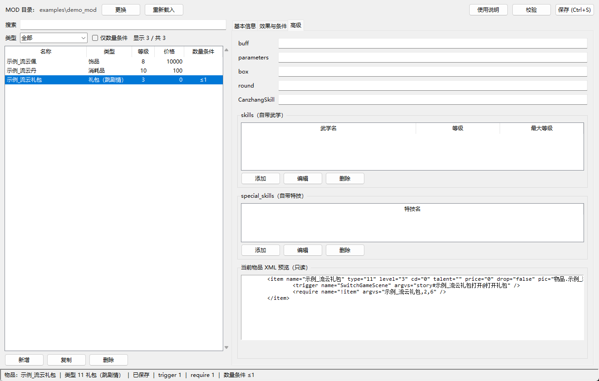

# 金庸群侠传X（JYX）MOD 物品编辑器

一个用于**图形化浏览、修改和新增《金庸群侠传X》MOD 物品**的桌面小工具，面向 `items.xml` 结构的 MOD 数据。

界面基于 Python `tkinter`，单文件实现，无数据库、无服务端；支持物品列表搜索筛选、基础属性编辑、`trigger` / `require` 编辑、图标导入、`resource.xml` 与 `index.xml` 自动登记、保存前校验和自动备份。

> 本仓库**只包含编辑器源代码和自制的演示数据**，不包含任何游戏本体、MOD 资源、图片、音频或反编译代码。  
> 本项目为非官方工具，与汉家松鼠工作室及游戏版权方无隶属关系。

## 适用游戏与使用场景

**适用游戏：金庸群侠传X（JYX，汉家松鼠工作室）**

本工具针对该游戏 MOD 的**明文数据结构**设计，尤其是 V123.x / WS123 一系的：

- `Scripts/items.xml`：物品定义
- `Scripts/resource.xml`：图标资源键映射
- `index.xml`：图标实际文件与像素尺寸登记
- `Items/`：图标图片目录

它不是通用物品编辑器，**不能修改游戏本体、APK、存档或引擎代码**。

### 可以用在什么情况下

| 场景 | 说明 |
|---|---|
| 浏览和检索 MOD 物品 | 按名称/说明/天赋搜索，按类型或数量条件筛选，快速核对属性与效果 |
| 修改现有物品 | 改名称、类型、等级、冷却、价格、掉落、天赋、图标、说明、`trigger`、`require` |
| 新增或复制物品 | 使用内置模板创建消耗品、武器、防具、饰品、心得、礼包、暗器等；复制后自动修正自身数量条件引用 |
| 维护图标资源 | 预览/导入图标，自动写入 `resource.xml` 与 `index.xml`，批量“补全索引” |
| 审计数量限制 | 查看 `!item` / `item` 数量条件的统计范围和上限，筛选出所有带数量条件的物品 |
| 制作和维护 JYX MOD | 直接编辑解包后的 MOD 目录，保存时自动备份，降低手改 XML 的出错概率 |

### 不适用的情况

- 其他游戏，或 `items.xml` 结构差异较大的 MOD（除非字段结构完全兼容）。
- 加密、压缩或打包后的 MOD；需要先解包成包含 `Scripts/items.xml` 的明文目录。
- 修改 Lua 脚本、剧情、商店、角色、地图、战斗等数据；本工具只处理 `items.xml` 及图标索引。
- 直接修改 APK、游戏本体或存档文件。

### 使用前提

1. 有一个已解包的明文 MOD 目录，至少包含 `Scripts/items.xml`。
2. 图标要真正在游戏中生效，需要同时存在：`Items/` 图片、`resource.xml` 映射、`index.xml` 尺寸登记。
3. 修改后需把 `items.xml`（以及 `resource.xml`、`index.xml`、图标）推送到设备 MOD 目录并**重启客户端**；`items.xml` 不参与 `reloadlua` 热重载。



## 功能

- **浏览**：1089 级别的物品列表也能流畅搜索、按类型筛选、按数量条件筛选。
- **编辑**：名称、类型、等级、冷却、价格、是否掉落、天赋、图标、说明。
- **效果**：`trigger` 表格增删改、上下移动，内置常用 trigger 名称提示。
- **条件**：`require` 表格增删改，自动生成中文说明；`!item` / `item` 数量条件支持结构化编辑。
- **新增 / 复制 / 删除**：内置空白、消耗品、武器、防具、饰品、心得、礼包、暗器、武学秘籍模板。
- **图标**：预览、打开、导入；导入时自动写入 `resource.xml` 和 `index.xml`。
- **校验**：重名、空字段、非法数字、图标映射缺失、`index.xml` 未登记、数量条件异常等。
- **安全**：保存前自动生成 `.bak_时间戳` 备份；改名/删除会提示跨文件引用风险。
- **自检**：内置 `--selftest`，不需要游戏数据即可验证解析/序列化/保存流程。





## 快速开始

### 环境要求

- Python 3.9+（Windows 官方 Python 自带 `tkinter`）
- Pillow（仅用于图标预览；不安装也能编辑，只是不显示缩略图）
- Windows / Linux / macOS 均可运行；仓库内的 `.bat` 仅适用于 Windows

```bash
python -m pip install -r requirements.txt
```

### 运行

```bash
# 1) 直接运行：优先打开仓库内的演示 MOD（examples/demo_mod）
python item_editor.py

# 2) 打开指定 MOD（目录下应有 Scripts/items.xml）
python item_editor.py --mod "D:\path\to\modcache\WS123"

# 3) Windows 也可以双击
run_editor.bat
```

也可以双击 `启动物品编辑器.bat`。

在未指定 `--mod` 时，程序按以下顺序查找默认 MOD：

1. `examples/demo_mod`（仓库演示数据）
2. `./WS123/mod/modcache/WS123`
3. 当前目录及脚本上级目录中的 `WS123/mod/modcache/WS123`

都找不到时，会弹出目录选择框；进入程序后也可以点顶部“更换”。

### 自检

```bash
python item_editor.py --selftest --mod examples/demo_mod
```

输出 `selftest: PASS` 即表示解析、序列化、临时目录保存、备份、`index.xml` 登记均正常。

## 界面说明

### 基本信息

- 左栏：搜索、类型筛选、“仅数量条件”筛选、物品列表。
- 右栏：名称、类型、等级、冷却、价格、可掉落、天赋、图标资源键、说明。
- 图标区：预览、打开原图、导入图片、补全索引。
- “还原当前物品”会从磁盘重新读取该物品，丢弃未保存的表单修改。

### 效果与条件

- `trigger`：物品效果，例如 `attribute`、`att_atk`、`powerup_skill`、`SwitchGameScene`。
- `require`：使用/装备条件，例如 `level`、`talent`、`dingli`、`!item`。
- 双击表格行可编辑；“数量条件…”提供结构化输入，不需要手写 `argvs`。
- 顶部会显示效果摘要和数量条件摘要。

### 高级

- `buff`、`parameters`、`box`、`round`、`CanzhangSkill`。
- `skills` / `special_skills`：物品自带武学/特技。
- 底部显示当前物品的 XML 预览，方便核对保存结果。

## 数据格式

### items.xml

```xml
<root>
    <item name="示例_流云佩" type="3" level="8" cd="0" talent="示例天赋"
          price="10000" drop="false" pic="物品.示例_流云佩"
          desc="【示例】流云一脉的玉佩。">
        <trigger name="attribute" argvs="生命上限百分率,10" />
        <trigger name="attribute" argvs="身法,50" />
        <require name="dingli" argvs="60" />
    </item>
</root>
```

常用属性：

| 属性 | 说明 |
|---|---|
| `name` | 唯一物品名，其他 XML 用它引用 |
| `type` | 物品类型，见下表 |
| `level` | 物品等级 / 需求等级 |
| `cd` | 使用冷却 |
| `talent` | 佩戴/使用获得的天赋，多个用 `#` 分隔 |
| `price` | 价格 / 价值 |
| `drop` | `false` 表示不可掉落 |
| `pic` | 图标资源键，如 `物品.示例_流云佩` |
| `desc` | 说明文字 |
| `buff` | 附加 Buff，部分类型使用 |
| `parameters` | 特殊参数串（暗器等） |
| `box` | 箱子/礼包相关标记 |
| `round` | 轮次相关，默认 1000 |
| `CanzhangSkill` | 残章对应武学 |

常见 `type`：

| type | 常见含义 |
|---|---|
| 0 | 消耗品 |
| 1 | 武器 |
| 2 | 防具 |
| 3 | 饰品 |
| 4 | 武学书 |
| 5 | 任务物品 |
| 6 | 特技书 |
| 7 | 天赋书 |
| 8 | 升级材料 / 丹药 |
| 9 | 特殊物品 |
| 10 | 残章 |
| 11 | 礼包（使用后跳剧情） |
| 12 | 心得 / 秘籍 |
| 13 | 武学秘籍（常见 NLS2 触发） |
| 14 | 暗器 |

> 类型含义来自常见 MOD 数据，具体行为以对应引擎为准。

### trigger 与 require

`trigger` 是物品效果：

```xml
<trigger name="attribute" argvs="身法,50" />
<trigger name="att_atk" argvs="200" />
<trigger name="powerup_skill" argvs="示例剑法,20" />
<trigger name="SwitchGameScene" argvs="story#示例礼包@打开礼包" />
```

`require` 是条件：

```xml
<require name="level" argvs="30" />
<require name="talent" argvs="示例天赋" />
<require name="dingli" argvs="60" />
<require name="!item" argvs="示例_流云礼包,2,6" />
```

## 数量条件（!item / item）

数量条件写在 `require` 中，`argvs` 格式为：

```
物品名,N,M
```

- `N`：数量阈值
- `M`：统计范围

| M | 统计范围 |
|---|---|
| 0 | 背包 |
| 1 | 角色装备 |
| 2 | 箱子 |
| 3 | 装备 + 背包 |
| 4 | 背包 + 箱子 |
| 5 | 装备 + 箱子 |
| 6+ | 装备 + 背包 + 箱子 |

两种前缀的方向不同：

| 写法 | 含义 | 示例 |
|---|---|---|
| `!item` | **数量上限**：合计数量必须 `< N`，即最多 `N-1` 个 | `!item 示例_流云礼包,2,6` → 装备+背包+箱子合计最多 1 个 |
| `item` | **数量下限**：合计数量必须 `≥ N` | `item 示例_流云礼包,2,6` → 合计至少 2 个 |

> 注意：`!item` 不是“至少 N 个”，而是“最多 N-1 个”。编辑器会按正确方向显示为 `≤1`，并在 require 说明列给出中文解释。

复制物品时，如果数量条件指向原物品自身，编辑器会自动改成新物品名；改名时也会同步自身引用，避免复制残留。

## 图标生效流程

一个 MOD 图标要真正生效，通常需要三处同时存在：

1. **图片文件**：放在 `MOD/Items/` 下，例如 `Items/my_icon.png`。
2. **resource.xml**：注册逻辑资源键。
   ```xml
   <resource key="物品.示例_流云佩" value="Items/demo_peiyu"/>
   ```
3. **index.xml**：登记实际文件与像素尺寸。
   ```xml
   <data url="Items/demo_peiyu.png" w="128" h="128" />
   ```

编辑器的“导入图片…”会一次完成这三步：

- 复制图片到 `Items/`
- 写入 `resource.xml`（新键或覆盖已有键）
- 用图片实际尺寸写入 `index.xml`

如果只改了资源键但历史图标缺少 `index.xml` 登记，可以点“补全索引”批量修复。校验也会提示：

```
index.xml 未登记图标：Items/xxx.png（游戏内可能无法加载）
```

## 保存、校验与备份

- `Ctrl+S` 保存；保存前执行校验。
- 有错误时阻止保存；警告和提示不会阻止。
- 保存时按需写入：
  - `Scripts/items.xml`
  - `Scripts/resource.xml`（有图标新增/覆盖时）
  - `index.xml`（有索引补登记时）
- 每个被写入的文件都会在同目录生成备份，例如：
  ```
  items.xml.bak_20261126_153000
  resource.xml.bak_20261126_153000
  index.xml.bak_20261126_153000
  ```
- 改名或删除物品时会提示：剧情、商店、NPC、掉落等其他 XML 不会自动同步。

## 校验规则

- 错误（阻止保存）
  - 物品名为空或重复
  - `type` 不在 0–14
  - `level` / `cd` / `price` / `box` / `round` 不是整数
  - `trigger` / `require` 名称为空
- 警告
  - 未设置 `pic`
  - `resource.xml` 缺少图标映射
  - `index.xml` 未登记图标
  - 数量条件参数不完整
- 提示
  - MOD 下缺少图标文件（可能使用内置资源）
  - 数量条件指向其他物品（可能是复制残留）
  - 全物品数量条件统计

## 快捷键

| 快捷键 | 作用 |
|---|---|
| `Ctrl+S` | 保存 |
| `Ctrl+F` | 聚焦搜索框 |
| `Delete` | 删除选中物品（列表获得焦点时） |
| 双击 trigger/require 行 | 编辑该行 |

## 目录结构

```
mod_item_editor/
├── item_editor.py                 # 主程序（单文件）
├── run_editor.bat                 # Windows 启动脚本
├── 启动物品编辑器.bat              # 中文启动脚本
├── requirements.txt
├── README.md
├── LICENSE
├── docs/
│   └── screenshots/
│       ├── basic.png
│       ├── effects.png
│       └── advanced.png
└── examples/
    └── demo_mod/                  # 自制演示 MOD（不含游戏资源）
        ├── index.xml
        ├── Items/
        │   ├── demo_peiyu.png
        │   ├── demo_dan.png
        │   └── demo_libao.png
        └── Scripts/
            ├── items.xml
            └── resource.xml
```

## 常见问题

**图标在编辑器里正常，游戏里不显示？**

依次检查：

1. `pic` 资源键是否在 `resource.xml` 中；
2. 对应图片是否在 `Items/` 下，大小写是否一致；
3. `index.xml` 是否有该文件的 `url` 和宽高登记；
4. 修改后是否已把文件推送到设备并重启游戏。

**保存后游戏没有变化？**

`items.xml` 不是 Lua 脚本，`reloadlua` 不会重新读取它。需要把 `Scripts/items.xml`（以及 `resource.xml`、`index.xml`、图标）推送到设备 MOD 目录，然后重启客户端。

**启动报 Tcl/Tk 找不到 init.tcl？**

通常是继承了其他程序的 `TCL_LIBRARY` / `TK_LIBRARY`。仓库内的 `run_editor.bat` 会先清空这两个变量；也可以手动执行：

```powershell
$env:TCL_LIBRARY=$null
$env:TK_LIBRARY=$null
python item_editor.py
```

**没有 Pillow 能用吗？**

可以编辑和保存，只是不显示图标缩略图；安装后即可预览：

```bash
python -m pip install Pillow
```

**`!item` 为什么显示 `≤1`？**

`!item 物品名,2,6` 的实际含义是“装备+背包+箱子合计必须小于 2”，也就是最多 1 个。显示 `≤1` 是正确的；`item` 才是“至少 N 个”。

**其他游戏能用吗？**

本工具只针对《金庸群侠传X》（JYX）系 MOD 的 `items.xml` 结构。其他游戏除非字段结构完全兼容，否则不建议直接使用。

## 已知限制

- 只编辑《金庸群侠传X》MOD 的 `Scripts/items.xml`；不会修改 `shops.xml`、`storys.xml`、`roles.xml`、`item_triggers.xml` 等引用文件。
- 改名或删除物品不会自动更新其他 XML 中的引用，保存前会提示风险。
- `index.xml` 只负责登记图标文件与尺寸；如果 MOD 目录本身没有 `index.xml`，需要先保证客户端能加载该 MOD 的资源索引。
- 不处理资源打包/压缩（例如 AssetBundle）；它直接读写 MOD 目录中的明文文件。
- 界面为桌面工具，未做移动端适配。

## 开发

- 运行环境：Python 3.9+，标准库 `tkinter` + 可选 `Pillow`。
- 数据层与界面在同一文件中，核心类：
  - `ItemStore`：`items.xml` / `resource.xml` / `index.xml` 的解析、序列化、备份与保存。
  - `App`：tkinter 界面与交互。
- 自检：

```bash
python item_editor.py --selftest --mod examples/demo_mod
```

- 修改解析/序列化逻辑后，建议同时用真实 MOD 副本运行一次：

```bash
python item_editor.py --selftest --mod "D:\path\to\modcache\WS123"
```

## 贡献

欢迎提交 Issue 或 Pull Request，但请注意：

- 不要提交游戏本体、MOD 资源、图片、音频、APK 或反编译代码。
- 演示数据请使用自制内容（参考 `examples/demo_mod`）。
- 提交前请确认 `--selftest` 通过。

## License

[MIT](LICENSE)

## 免责声明

本项目是非官方的《金庸群侠传X》MOD 辅助工具，与汉家松鼠工作室及游戏版权方无隶属关系。仓库仅包含编辑器代码与自制演示数据；使用者对自己创建、修改和分发的 MOD 内容负责，请遵守当地法律及相关版权许可。
